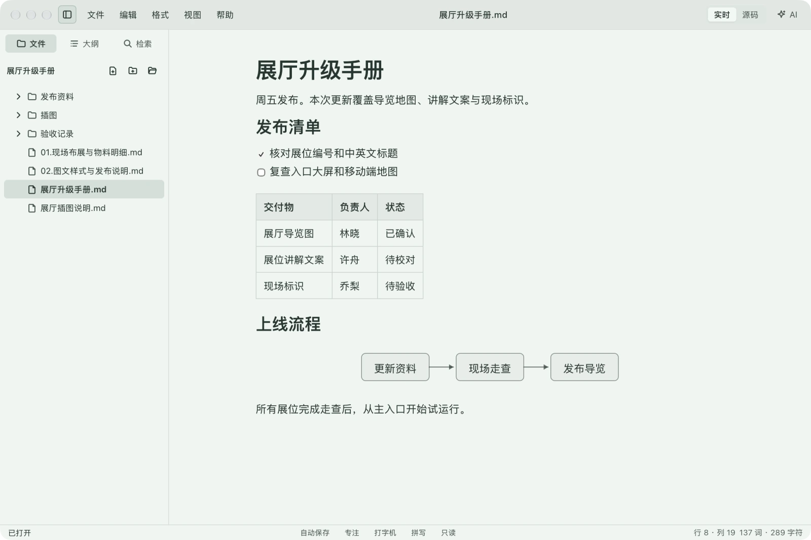
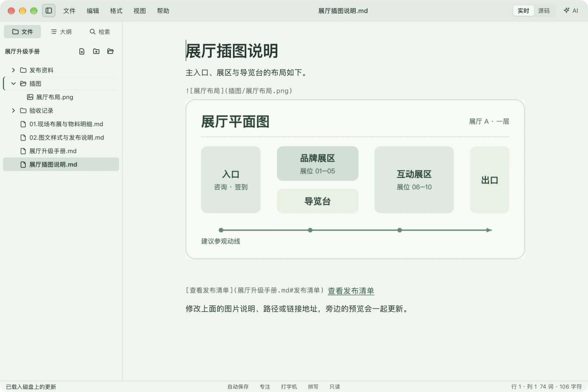

<p align="center"></p>
<h1 align="center">墨笺 Markdown</h1>
<p align="center">把笔记、插图和草稿放进一个文件夹，打开就能写。</p>

<p align="center">
  <a href="https://github.com/Lw5959/inkletter-markdown/releases/latest">下载墨笺</a> ·
  <a href="docs/guide.md">使用说明</a> ·
  <a href="https://lw5959.github.io/inkletter-plugin-market/">插件市场</a>
</p>



## 用墨笺写什么

- **写项目文档。** 打开整个文件夹，按目录浏览，跨文件搜索，再从大纲跳到标题。笔记是普通 `.md` 文件，离线也能新建、编辑和保存。
- **直接改表格、图和链接。** 在实时模式点击单元格就能改值，点击 Mermaid 图表就能修改代码。图片和链接的预览旁保留 Markdown 原文，改说明、路径或地址时眼前就有对照。
- **把改稿交给 AI，再亲手定稿。** 选一段文字做润色、翻译或提取待办，审阅修改前后的差异，按段应用和撤销。可以使用自己的模型服务，也能接通 MCP 工具或离线安装内置插件。
- **交稿和分享。** 按主题排版导出 HTML、PDF、长图或 Word 文档。已有 Typora 主题和偏好也可以迁移进来。 [导出](docs/guide.md#导出和更新) · [从 Typora 迁移](docs/guide.md#从-typora-迁移)



## 开始使用

| 系统 | 安装包 |
| --- | --- |
| macOS | Apple Silicon 选 `arm64.dmg`，Intel 选 `x64.dmg` |
| Windows | x64 安装程序 |
| Linux | x64 或 ARM64 的 DEB、AppImage |
| Android | ARM64 APK，预览版 |

从发布页选安装包。打开墨笺，选「文件 → 打开文件夹…」，再点左侧的 Markdown 或图片。编辑区右键可找格式、剪贴板和查找操作。 [GitHub 下载](https://github.com/Lw5959/inkletter-markdown/releases/latest) · [Gitee 下载](https://gitee.com/Lw5959/inkletter-markdown/releases) · [完整使用说明](docs/guide.md)

## 从源码运行

需要 Node.js 24、pnpm 10、Rust 稳定版和目标平台的编译工具。

```sh
pnpm install --frozen-lockfile
pnpm tauri dev
```

[平台依赖和打包](docs/releases.md#生成安装包) · [应用结构](docs/architecture.md) · [功能对照](docs/feature-matrix.md) · [验收记录](docs/verification.md)

[MIT 许可证](LICENSE)
