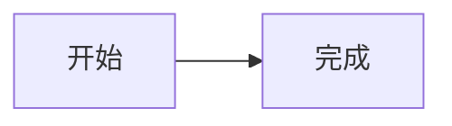

# 页屿实机验收

[TOC]

原始段落：中文、English 和 emoji 📝。

The draft is wordy.

## 表格与任务

| 想法 | 状态 |
| :--- | ---: |
| 开始写作 | 就绪 |

- [x] 普通 Markdown
- [ ] 保留原始写法

## 公式与图表

内联公式 $E=mc^2$ 和脚注[^note]。

$$
\frac{1}{1+x}
$$



```ts
const state = "已完成"
```


[^note]: 这段文字在导出中保留。

:::custom
未知块的原文应该保留。
:::
